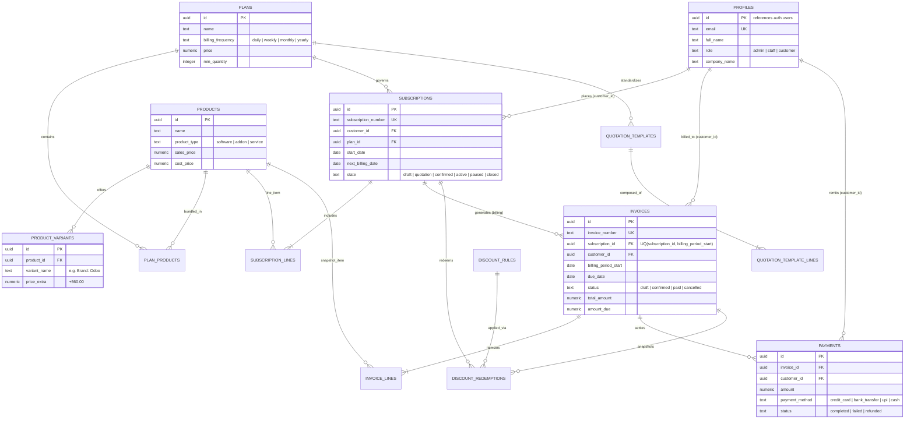

# Database Diagrams & Architecture Visualizations
## Brightloop Software Subscription Management System

**Assigned Engineer:** Harsha (`harsha-1706`), Database Engineer  
**Status:** Architecture Implemented  

---

## 1. Entity-Relationship Diagram (ERD)

The diagram source file is also maintained at [`schema_erd.mmd`](./schema_erd.mmd).
