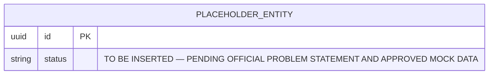

# Database Diagrams & Architecture Visualizations
## Odoo National Level Hackathon 2026

**Assigned Engineer:** Harsha (`harsha-1706`), Database Engineer  
**Status:** Stage 1 — Workspace Preparation  

---

## 1. Overview

This directory stores visual models, Entity-Relationship Diagrams (ERDs), and data flow documentation for the hackathon application.

1. **Format Standards:**
   - Text-based diagrams rendered using standard GitHub-compatible Mermaid (`.mmd` or inline markdown blocks).
   - High-resolution SVG / PNG exports for presentation slides and `docs/DEMO_SCRIPT.md`.
2. **Traceability:**
   - Every diagram must directly reflect the SQL implementation in `database/schema/` and `database/migrations/`.

---

## 2. Entity-Relationship Diagram (ERD)

