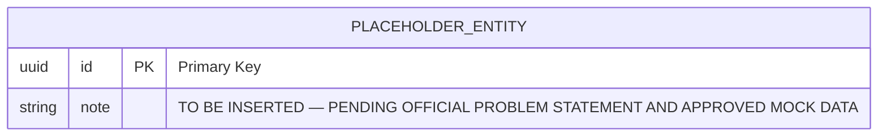

# Database Design & Architecture Specification
## Odoo National Level Hackathon 2026

**Document Status:** Stage 1 — Workspace Preparation (Foundation)  
**Assigned Database Engineer:** Harsha (`harsha-1706`)  
**Target Feature Branch:** `feature/harsha-supabase-setup`  
**Primary Engine:** Supabase PostgreSQL  
**Access Control:** PostgreSQL Row Level Security (RLS) & Supabase Auth  
**Backend Integration:** Node.js / Express Services  

---

## 1. Architectural Foundation & Strategy

1. **Single Primary Datastore:**
   - Supabase PostgreSQL serves as the definitive single primary database for all core application entities.
   - No secondary operational database (e.g. local MySQL) is permitted in production/team workflows.
2. **Keying & Identity Standards:**
   - Primary Keys: Standardized on `UUID` (`gen_random_uuid()`) for distributed scalability and integration with Supabase Auth identities, or auto-incrementing `BIGINT` where sequential ordering is strictly necessary.
   - Foreign Keys: Explicitly defined with foreign key constraints, indexed for join performance, with defined referential actions (`ON DELETE RESTRICT` or `ON DELETE CASCADE` where applicable).
3. **Auditability & Lifecycles:**
   - Standard timestamp columns: `created_at TIMESTAMPTZ NOT NULL DEFAULT timezone('utc'::text, now())` and `updated_at TIMESTAMPTZ NOT NULL DEFAULT timezone('utc'::text, now())` on all core tables.
   - Automated timestamp triggers (`moddatetime` or custom trigger functions) for maintaining `updated_at`.
   - Soft-delete pattern (`deleted_at TIMESTAMPTZ NULL`) applied only where historical audit trails or regulatory compliance require it.
4. **Data Integrity & Normalization:**
   - Target schema normalized to Third Normal Form (3NF) to prevent anomalies and data duplication.
   - Database-level integrity enforced via strict constraints (`NOT NULL`, `CHECK`, `UNIQUE`, foreign key references).

---

## 2. Entity Register & Domain Model

> **Status:** Pending release of official hackathon problem statement.

`TO BE INSERTED — PENDING OFFICIAL PROBLEM STATEMENT AND APPROVED MOCK DATA`

### Registered Entities

| Entity Name | Primary Key | Description | Relationships | Ownership / Scope |
|---|---|---|---|---|
| *TO BE INSERTED* | *TO BE INSERTED* | `TO BE INSERTED — PENDING OFFICIAL PROBLEM STATEMENT AND APPROVED MOCK DATA` | *TO BE INSERTED* | *TO BE INSERTED* |

---

## 3. Entity Relationship Diagram (ERD)

---

## 4. Comprehensive Data Dictionary

> **Status:** Pending release of official hackathon problem statement and approved mock dataset.

`TO BE INSERTED — PENDING OFFICIAL PROBLEM STATEMENT AND APPROVED MOCK DATA`

### Table Schema Definitions

| Table | Column | Data Type | Nullable | Default | Constraints | Description |
|---|---|---|---|---|---|---|
| *TO BE INSERTED* | *TO BE INSERTED* | *TO BE INSERTED* | *TO BE INSERTED* | *TO BE INSERTED* | *TO BE INSERTED* | `TO BE INSERTED — PENDING OFFICIAL PROBLEM STATEMENT AND APPROVED MOCK DATA` |

---

## 5. Constraint & Validation Registry

- **Domain Constraints:** Checked at the database layer via PostgreSQL `CHECK` constraints (e.g., positive numeric balances, enum validation, string length limits).
- **Uniqueness Guarantees:** Multi-column and single-column `UNIQUE` constraints to enforce business invariants.
- **Referential Integrity:** Explicit foreign key declarations preventing orphaned records.

`TO BE INSERTED — PENDING OFFICIAL PROBLEM STATEMENT AND APPROVED MOCK DATA`

---

## 6. Indexing & Query Optimization Strategy

1. **Foreign Key Indexing:** B-Tree index created on every foreign key column to optimize joins and cascading checks.
2. **Filter & Lookup Indexing:** Targeted composite indexes for query patterns identified in backend API contracts (`docs/API_CONTRACTS.md`).
3. **Full-Text & Partial Indexes:** Applied where search operations or active record filters (`WHERE deleted_at IS NULL`) are frequent.

`TO BE INSERTED — PENDING OFFICIAL PROBLEM STATEMENT AND APPROVED MOCK DATA`

---

## 7. Row Level Security (RLS) & Access Control

1. **Zero-Trust Baseline:**
   - Every application table created in Supabase PostgreSQL must explicitly execute `ALTER TABLE <table_name> ENABLE ROW LEVEL SECURITY;`.
   - By default, tables with RLS enabled deny all access to public and authenticated roles until explicit policies are granted.
2. **Policy Dimensions:**
   - **Public Read (SELECT):** Granted only to public catalog or reference data.
   - **Authenticated User Isolation (SELECT/INSERT/UPDATE/DELETE):** Scoped to `auth.uid() = user_id` for individual tenant data.
   - **Role-Based Policies:** Scoped via application roles or JWT custom claims for administrative operations.
   - **Service Role Bypass:** Server-side operations in Node.js backend using `SUPABASE_SERVICE_ROLE_KEY` bypass RLS for administrative background processes, but customer-facing operations must respect security contexts.

`TO BE INSERTED — PENDING OFFICIAL PROBLEM STATEMENT AND APPROVED MOCK DATA`

---

## 8. Migration, Seeding & Version Control Guidelines

1. **Migration Sequencing:**
   - Migrations are sequential SQL files stored in `database/migrations/` using timestamped or numbered prefixes: `001_<description>.sql`, `002_<description>.sql`.
   - Each migration must be deterministic, idempotent where feasible, and tested in both forward execution and rollback scenarios.
2. **Seed Data Management:**
   - Realistic, approved mock datasets stored in `database/seeds/` as reproducible SQL or JSON/TS import scripts.
   - Seed scripts must cleanly handle dependencies between parent and child tables.
3. **Audit & Changelog:**
   - Major schema changes tracked in `database/history/CHANGELOG.md` with rationale, author, and impact assessment.
