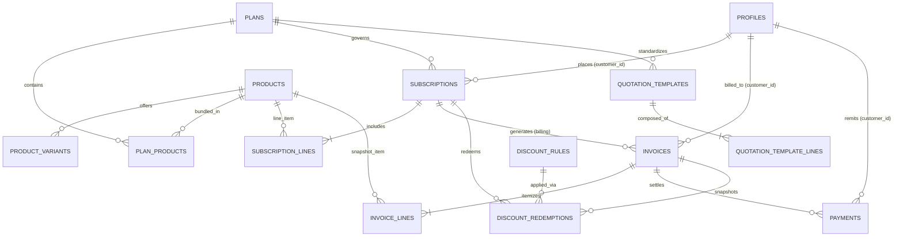

# Database Design & Architecture Specification
## Brightloop Software Subscription Management System
### Odoo National Level Hackathon 2026

**Assigned Database Engineer:** Harsha (`harsha-1706`)  
**Target Feature Branch:** `feature/harsha-supabase-setup`  
**Primary Engine:** Supabase PostgreSQL 15+  
**Target Dev Project Reference:** `sldgofxhcfswcmcpebwv` (`Odoo Hackathon Dev`)  
**Shared Project Reference:** `bdmwwpfglitcpagwblmk` (`Odoo Hackathon` — Protected)  
**Access Control:** PostgreSQL Row Level Security (RLS) & Supabase Auth  
**Backend Integration:** Node.js / Express API (`@supabase/supabase-js`, direct `pg`)  

---

## 1. Architectural Foundation & Core Invariants

1. **Single Primary Datastore:**
   - Supabase PostgreSQL is the sole primary database for Brightloop Software.
   - All monetary figures strictly utilize `NUMERIC(12, 2)` to eliminate floating-point representation anomalies.
2. **Keying & Identity Standards:**
   - Primary Keys: Standardized on `UUID` (`gen_random_uuid()`).
   - User identity linked directly to `auth.users(id)` in `profiles`.
3. **Auditability & Lifecycles:**
   - Standard audit columns: `created_at` and `updated_at` with automated trigger synchronization.
4. **Recurring Billing Invariant (High Priority):**
   - The database guarantees that duplicate invoices cannot be generated for the same subscription in the same billing cycle via:
     `CONSTRAINT uq_subscription_billing_period UNIQUE (subscription_id, billing_period_start)`
   - The atomic billing procedure `public.fn_generate_due_invoice()` encapsulates row-level locking (`FOR UPDATE`), invoice line snapshotting, discount redemption, and next billing date advancement inside an atomic transaction.

---

## 2. Entity Register & Domain Model

| Entity Name | Primary Key | Description | Relationships | Ownership / Scope |
|---|---|---|---|---|
| `profiles` | `UUID (auth.users)` | Application user profiles, company info, and role assignments (`admin`, `staff`, `customer`). | Links to Auth, Subscriptions, Invoices, Payments | Private to user; admin/staff viewable |
| `products` | `UUID` | Software, add-on, and service catalog items with sales & cost prices. | Parent to Variants, Plan mappings | Public / Authenticated read |
| `product_variants` | `UUID` | Product variants with price adjustments (e.g., Odoo Brand adding +560.00). | Child of `products` | Public / Authenticated read |
| `plans` | `UUID` | Subscription plans with frequency (daily, weekly, monthly, yearly) and lifecycle policies. | Parent to Subscriptions, Quotes | Public / Authenticated read |
| `plan_products` | `(plan_id, product_id)` | Associative mapping of products bundled within plans. | Join `plans` & `products` | Public read |
| `quotation_templates` | `UUID` | Predefined quotation templates for sales offers with validity periods. | Child of `plans` | Staff / Admin |
| `quotation_template_lines` | `UUID` | Line items included in a quotation template. | Child of `quotation_templates` | Staff / Admin |
| `subscriptions` | `UUID` | Active contracts with unique subscription numbers, lifecycle states, and billing dates. | Child of `profiles`, `plans` | Scoped to `customer_id` |
| `subscription_lines` | `UUID` | Individual product/variant quantities and unit prices on a subscription. | Child of `subscriptions` | Scoped to parent subscription |
| `tax_rules` | `UUID` | Tax rules and percentage rates (e.g. GST 18%). | Applied to Invoices | Public read; Admin write |
| `discount_rules` | `UUID` | Fixed or percentage discounts with usage thresholds and expiration dates. | Referenced by Redemptions | Public read; Admin write |
| `discount_redemptions` | `UUID` | Historical record of discounts applied to specific invoices. | Child of `discount_rules`, `invoices` | Scoped to customer |
| `invoices` | `UUID` | Billing documents with financial totals, tax, and discount snapshots. | Child of `subscriptions`, `profiles` | Scoped to `customer_id` |
| `invoice_lines` | `UUID` | Immutable price and tax snapshots for historical accounting accuracy. | Child of `invoices` | Scoped to parent invoice |
| `payments` | `UUID` | Financial transactions recorded against invoices with automated balance reconciliation. | Child of `invoices`, `profiles` | Scoped to `customer_id` |

---

## 3. Entity-Relationship Diagram (ERD)

---

## 4. Comprehensive Data Dictionary

### Core Tables

#### `profiles`
- `id` (UUID, PK, REFERENCES `auth.users(id)` ON DELETE CASCADE)
- `email` (TEXT, UNIQUE, NOT NULL)
- `full_name` (TEXT, NOT NULL)
- `role` (TEXT, NOT NULL, CHECK in `'admin'`, `'staff'`, `'customer'`, DEFAULT `'customer'`)
- `company_name` (TEXT, NULL)
- `phone` (TEXT, NULL)
- `created_at` (TIMESTAMPTZ, NOT NULL, DEFAULT `timezone('utc', now())`)
- `updated_at` (TIMESTAMPTZ, NOT NULL, DEFAULT `timezone('utc', now())`)

#### `products`
- `id` (UUID, PK, DEFAULT `gen_random_uuid()`)
- `name` (TEXT, NOT NULL)
- `product_type` (TEXT, CHECK in `'software'`, `'addon'`, `'service'`, DEFAULT `'software'`)
- `sales_price` (NUMERIC(12, 2), NOT NULL, CHECK `>= 0`)
- `cost_price` (NUMERIC(12, 2), NOT NULL, DEFAULT `0.00`, CHECK `>= 0`)
- `notes` (TEXT, NULL)
- `is_active` (BOOLEAN, NOT NULL, DEFAULT `true`)
- `created_at`, `updated_at` (TIMESTAMPTZ)

#### `product_variants`
- `id` (UUID, PK, DEFAULT `gen_random_uuid()`)
- `product_id` (UUID, NOT NULL, REFERENCES `products(id)` ON DELETE CASCADE)
- `variant_name` (TEXT, NOT NULL) — e.g. `'Brand: Odoo Integration Edition'`
- `price_extra` (NUMERIC(12, 2), NOT NULL, DEFAULT `0.00`, CHECK `>= 0`) — Adds `560.00` for Odoo brand
- `sku` (TEXT, UNIQUE, NULL)
- `is_active` (BOOLEAN, NOT NULL, DEFAULT `true`)

#### `subscriptions`
- `id` (UUID, PK, DEFAULT `gen_random_uuid()`)
- `subscription_number` (TEXT, UNIQUE, NOT NULL)
- `customer_id` (UUID, NOT NULL, REFERENCES `profiles(id)`)
- `plan_id` (UUID, NOT NULL, REFERENCES `plans(id)`)
- `start_date` (DATE, NOT NULL)
- `expiry_date` (DATE, NULL, CHECK `expiry_date >= start_date`)
- `payment_terms` (TEXT, DEFAULT `'Immediate'`)
- `state` (TEXT, CHECK in `'draft'`, `'quotation'`, `'confirmed'`, `'active'`, `'paused'`, `'closed'`, DEFAULT `'draft'`)
- `next_billing_date` (DATE, NULL)
- `billing_frequency` (TEXT, CHECK in `'daily'`, `'weekly'`, `'monthly'`, `'yearly'`)
- `is_paused` (BOOLEAN, DEFAULT `false`)
- `pause_date`, `resume_date` (DATE, NULL)

#### `invoices`
- `id` (UUID, PK, DEFAULT `gen_random_uuid()`)
- `invoice_number` (TEXT, UNIQUE, NOT NULL)
- `subscription_id` (UUID, NOT NULL, REFERENCES `subscriptions(id)`)
- `customer_id` (UUID, NOT NULL, REFERENCES `profiles(id)`)
- `billing_period_start` (DATE, NOT NULL)
- `billing_period_end` (DATE, NOT NULL, CHECK `billing_period_end >= billing_period_start`)
- `issue_date` (DATE, NOT NULL, DEFAULT `CURRENT_DATE`)
- `due_date` (DATE, NOT NULL)
- `status` (TEXT, CHECK in `'draft'`, `'confirmed'`, `'paid'`, `'cancelled'`, DEFAULT `'draft'`)
- `subtotal`, `tax_amount`, `discount_amount`, `total_amount`, `amount_paid`, `amount_due` (NUMERIC(12, 2), NOT NULL)
- **Constraint:** `CONSTRAINT uq_subscription_billing_period UNIQUE (subscription_id, billing_period_start)`

---

## 5. Row Level Security (RLS) Policy Catalog

| Table | Policy Name | Command | Who | Using Condition |
|---|---|---|---|---|
| `profiles` | `p_profiles_select` | `SELECT` | Self / Staff / Admin | `id = auth.uid() OR role IN ('admin', 'staff')` |
| `subscriptions` | `p_subscriptions_select` | `SELECT` | Customer / Staff / Admin | `customer_id = auth.uid() OR role IN ('admin', 'staff')` |
| `subscription_lines` | `p_subscription_lines_select` | `SELECT` | Customer / Staff / Admin | Via parent `subscription.customer_id = auth.uid()` |
| `invoices` | `p_invoices_select` | `SELECT` | Customer / Staff / Admin | `customer_id = auth.uid() OR role IN ('admin', 'staff')` |
| `invoice_lines` | `p_invoice_lines_select` | `SELECT` | Customer / Staff / Admin | Via parent `invoice.customer_id = auth.uid()` |
| `payments` | `p_payments_select` | `SELECT` | Customer / Staff / Admin | `customer_id = auth.uid() OR role IN ('admin', 'staff')` |
| `products`, `plans` | `p_products_select`, `p_plans_select` | `SELECT` | Public / Authenticated | `is_active = true OR role IN ('admin', 'staff')` |
| Administrative Tables | `*_admin_all` | `ALL` | Admin | `role = 'admin'` |

---

## 6. Query Optimization & Indexing Strategy

1. **Foreign Keys:** B-Tree index on all foreign keys (`customer_id`, `plan_id`, `subscription_id`, `invoice_id`).
2. **Recurring Billing Engine:** Partial index `idx_subscriptions_due_billing` on `(next_billing_date, state, is_paused)` where `state IN ('confirmed', 'active') AND is_paused = false`.
3. **Overdue Invoices:** Partial index `idx_invoices_overdue` on `(due_date, status, amount_due)` where `status = 'confirmed' AND amount_due > 0`.
4. **Revenue Reporting:** Composite index `idx_payments_reporting` on `(payment_date, status, amount)` where `status = 'completed'`.
