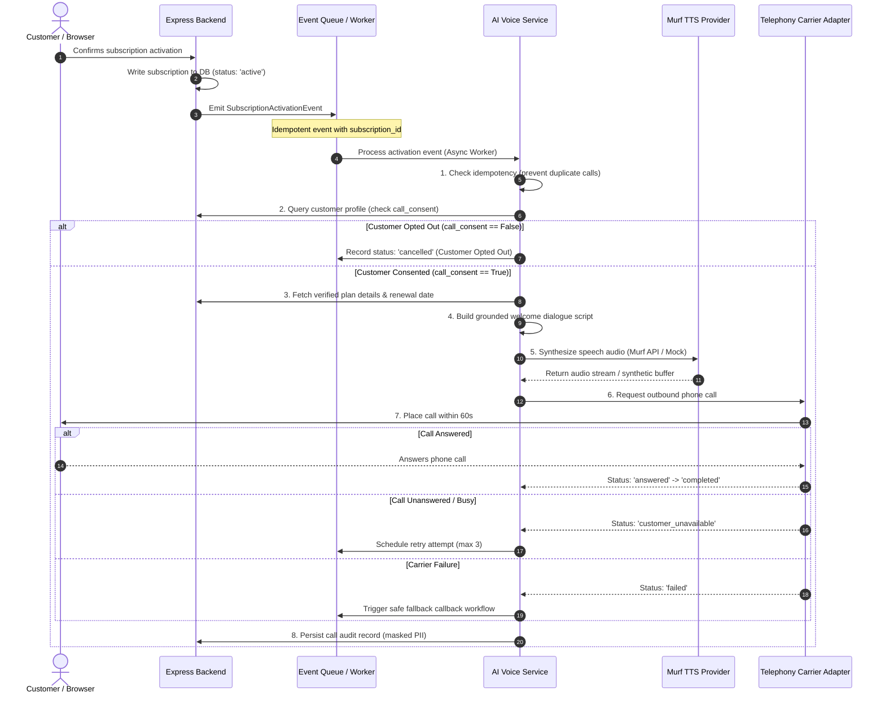

# AI Subscription Assistance Call — Workflow & Operational Blueprint

> **Feature Name:** Brightloop AI Assistance Call  
> **Document Status:** Implemented and tested (Mock Telephony & Voice layer); production carrier adapter proposed.  
> **Owner:** Sanju (`@sanjuskb`)  
> **Date:** 31 October 2026  

---

## 1. Feature Purpose & Value Proposition

When a customer successfully activates an eligible subscription in Brightloop, the system automatically schedules an **AI Assistance Call** targeted within **60 seconds** of activation.

The phone call welcomes the customer, introduces Brightloop, confirms the activated plan tier and renewal date, and checks whether the customer needs setup assistance, billing configuration guidance, or escalation to human customer care.

---

## 2. End-to-End Workflow Diagram



---

## 3. Critical Safety & Reliability Invariants

1. **Non-Blocking Execution:** Subscription activation must **never** block on phone call dispatch. The event must be queued and executed in an asynchronous background job.
2. **Idempotency Guarantee:** Multiple activation events for the same subscription ID must never place redundant calls. The service deduplicates via `idempotency_key = subscription_id:plan_id`.
3. **Explicit Consent & Opt-Out:** Customer records must contain `call_consent: true`. If `call_consent: false`, the call is immediately cancelled with an audit entry.
4. **PII Masking:** Logs and status responses must NEVER display unmasked telephone numbers (e.g. stored/reported as `+1-***-***-0199`).
5. **TTS Fallback:** If the Murf TTS service times out or is offline, the telephony adapter proceeds using an interactive text-to-speech fallback stream without crashing.
6. **Bounded Retry Policy:** Maximum 3 retry attempts for `customer_unavailable` states before permanently marking the call as `failed`.
7. **Simulated vs. Real Disclose:** The `is_simulated` boolean flag is explicitly returned on every call record so evaluators and operators can instantly distinguish simulated runs from live carrier dispatches.

---

## 4. Event & API Schemas

### 4.1 Activation Event Schema
```json
{
  "event_id": "evt-77a83d-9912",
  "subscription_id": "sub-101",
  "customer_id": "cust-101",
  "plan_id": "plan-pro",
  "plan_name": "Professional Plan",
  "status": "active",
  "activated_at": "2026-10-31T10:00:00Z",
  "idempotency_key": "sub-101:plan-pro"
}
```

### 4.2 Call Status Response Schema
```json
{
  "call_id": "call-a938c019df",
  "event_id": "evt-77a83d-9912",
  "subscription_id": "sub-101",
  "customer_id": "cust-101",
  "customer_phone_masked": "+1-****0199",
  "status": "completed",
  "provider_name": "MockTelephonyService",
  "provider_call_id": "mock-tel-88c9f2b",
  "scheduled_at": "2026-10-31T10:00:05Z",
  "initiated_at": "2026-10-31T10:00:12Z",
  "completed_at": "2026-10-31T10:00:54Z",
  "duration_seconds": 42.5,
  "retry_count": 0,
  "max_retries": 3,
  "dialogue_script": "Hello Sanju Customer, this is Brightloop Subscription Support calling to welcome you! ...",
  "audio_synthesized": true,
  "is_simulated": true,
  "failure_reason": null
}
```

