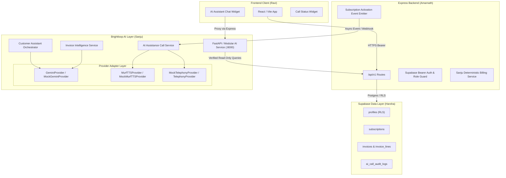

# Brightloop AI Foundation — Architecture Specification

> **Document Status:** Implemented and tested (Foundation layer); integration contracts with Express backend awaiting team review.  
> **Lead & Module Owner:** Sanju (`@sanjuskb`) — Team Lead, Deterministic Invoice-Generation Owner, AI Innovation Lead  
> **Primary Collaborators:** Amarnath (`@amarnathgaddam75`, Backend API Integration), Ravi (`@donnyravi-alt`, Frontend UI/UX), Harsha (`@harsha-1706`, Database & Schema)  
> **Latest Update:** 31 October 2026  

---

## 1. Executive Summary & Design Philosophy

The **Brightloop AI Foundation** provides an independently testable, decoupled, and secure intelligence layer for the Brightloop Subscription Management System. 

### Core Architectural Axioms:
1. **Financial Authority Separation:** AI models are **strictly non-authoritative**. AI NEVER calculates money totals, tax amounts, discount deductions, outstanding balances, or ledger states. All financial calculations remain deterministic backend code owned by Sanju and Harsha.
2. **Grounded Read-Only Assistant:** All customer and subscription information presented by the chatbot is fetched exclusively through verified backend session tokens and database-backed APIs.
3. **Provider Agnostic Adapters:** Clean interface abstractions decouple the system from external vendor APIs (Google Gemini, Murf TTS, Telephony carriers), permitting 100% offline development, CI verification, and instant provider swapping without application refactoring.
4. **Zero-Trust Customer Isolation:** The AI assistant strictly validates authenticated customer sessions and never permits prompt-based cross-customer data probing.

---

## 2. High-Level System Architecture

---

## 3. Subsystem Breakdown

### 3.1 Gemini LLM Provider Layer
- **Interface:** `BaseLLMProvider` (`ai/src/providers/llm_base.py`)
- **Implementations:**
  - `GeminiProvider`: Direct REST adapter to Google Gemini Generative Language API using server-side secrets (`GEMINI_API_KEY`).
  - `MockGeminiProvider`: Deterministic in-memory simulation engine for tests, handling mock chat, simulated timeouts, rate limits, and grounded responses.
- **Contract Status:** Implemented and tested.

### 3.2 Customer Assistant Orchestration
- **Service:** `CustomerAssistantOrchestrator` (`ai/src/assistant/chatbot.py`)
- **Supported Intents:**
  1. `explain_available_plans`
  2. `show_active_subscriptions`
  3. `explain_subscribed_plan`
  4. `show_renewal_info`
  5. `retrieve_invoices`
  6. `explain_invoice`
  7. `explain_payment_status`
  8. `show_outstanding_amount`
  9. `explain_upgrade_options`
  10. `contact_support`
- **Security Boundaries:** Enforces `AuthenticatedCustomerContext`. Binds all data queries strictly to `context.customer_id`.
- **Contract Status:** Implemented and tested.

### 3.3 AI Subscription Assistance Call (Voice Innovation)
- **Service:** `AIAssistanceCallService` (`ai/src/voice/assistance_call_service.py`)
- **Workflow:** 
  1. Triggered asynchronously upon verified subscription activation (`SubscriptionActivationEvent`).
  2. Idempotency filter deduplicates events by `subscription_id` to prevent repeated phone calls.
  3. Verified customer consent (`call_consent: true`) is required before placing any call.
  4. Generates grounded onboarding script explaining subscribed tier and upcoming renewal date.
  5. Murf TTS synthesizes personalized audio greeting.
  6. Dispatches to Telephony adapter with retry workflow and PII masking.
- **Contract Status:** Implemented and tested (Mock Telephony & Mock Murf); carrier contract proposed.

### 3.4 Murf Text-to-Speech (TTS) Provider Layer
- **Interface:** `BaseTTSProvider` (`ai/src/providers/tts_base.py`)
- **Implementations:**
  - `MurfTTSProvider`: Generates voice audio via Murf Studio API with server-side API key.
  - `MockMurfTTSProvider`: Deterministic offline audio synthesis and duration calculation.
- **Contract Status:** Implemented and tested.

### 3.5 Invoice Intelligence & Explanation Service
- **Service:** `InvoiceExplanationService` (`ai/src/invoice/invoice_explainer.py`)
- **Rule:** Read-only explanation of already calculated and persisted database invoices. Strictly prohibits AI calculation or alteration of monetary numbers.
- **Contract Status:** Implemented and tested.

---

## 4. Integration Matrix

| Team Member | Module | Interface Boundary | Status |
|---|---|---|---|
| **Sanju** | AI Foundation | FastAPI & Python package, provider adapters, mock suite | Implemented and tested |
| **Sanju** | Deterministic Billing Engine | Billing-period orchestration, invariant calculations | Assigned (P0 in progress) |
| **Amarnath** | Backend Express API | Reverse proxy `/api/v1/assistant/*`, `/api/v1/voice/*` | Proposed, awaiting team approval |
| **Ravi** | Frontend React UI | Assistant Chat modal, customer assistance call status banner | Proposed contract ready |
| **Harsha** | Supabase Database | Customer profile `call_consent` boolean, audit log table | Proposed schema ready |

