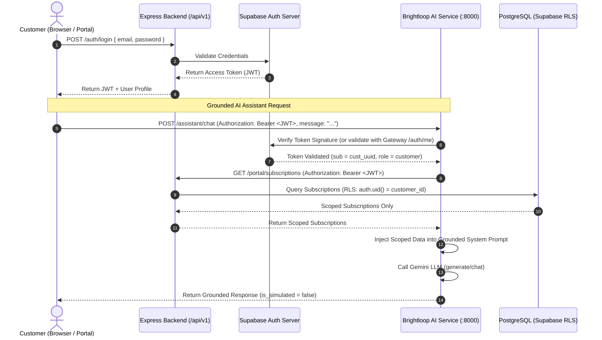

# Production Authentication & Multi-Tenant Security Design — Brightloop AI

> **Document:** `docs/ai/PRODUCTION_AUTH_SECURITY_DESIGN.md`  
> **Author:** Sanju (AI & Integration Lead)  
> **Date:** 2026-10-31  
> **Repository:** `odoo-national-hackathon-2026`  

---

## 1. Threat Model & Vulnerability Analysis

### Current Demo Architecture (Insecure for Production)
In the evaluator demo dashboard (`ai/src/integrations/demo_page.py`):
```javascript
// Browser sends client-selected identity in JSON body:
fetch("/assistant/chat", {
  body: JSON.stringify({
    message: msg,
    context: { customer_id: "cust-101", role: "customer" } // UNTRUSTED CLIENT INPUT
  })
});
```
**Risk:** An attacker can forge the JSON payload, substitute `customer_id: "victim_uuid"`, and prompt the AI to inspect or summarize the victim's subscription and invoice records.

### Production Requirement (Zero-Trust Identity Scoping)
1. The browser **never** provides `customer_id` or `role` directly.
2. The browser supplies a cryptographically verified Supabase JWT via the standard HTTP header:
   `Authorization: Bearer <supabase_access_token>`.
3. The AI service (or Express backend gateway) verifies the token signature against Supabase Auth.
4. `customer_id` is derived **server-side** from the verified token (`auth.uid`).
5. Client-supplied IDs in arbitrary JSON are strictly ignored or rejected.

---

## 2. Production Authentication Flow



---

## 3. Defense-in-Depth Principles

1. **No Secret Leaks:**
   - Supabase `service_role` keys are **never** shared with the frontend or AI microservice.
   - Gemini API keys remain strictly on the AI server in local `.env` and are never exposed over HTTP.

2. **Fail-Closed Authorization:**
   - If an incoming Bearer token is expired, tampered with, or missing, the AI service immediately responds with `HTTP 401 Unauthorized` without calling the LLM or querying data.
   - If a customer attempts to query another customer's invoice (`invoice.customer_id != verified_user.id`), the system raises `CrossCustomerAccessError` resulting in an immediate `HTTP 403 Forbidden`.

3. **Grounded Read-Only Invariant:**
   - The AI Assistant and Invoice Explainer have read-only access to customer data.
   - The AI service does not possess database write credentials and cannot update balances, modify subscriptions, or apply unapproved discounts.
   - All financial mutations happen exclusively via Express backend endpoints and PostgreSQL RPC transactions.

