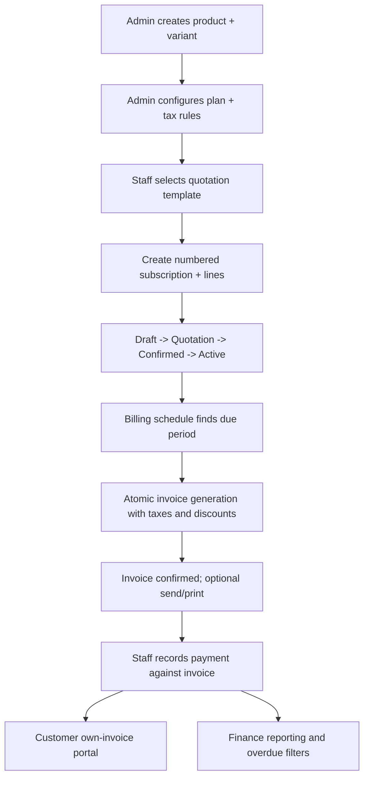

# User workflows — linked to source requirements

## Admin catalogue to finance report

## Signup and access (PDF p.2)
Customer submits email/password -> validation + unique email -> Supabase Auth (team-approved option) -> role-based UI -> only owned subscriptions/invoices. Forgotten password -> email reset link. Admin adds staff; non-admin request denied.

## Plan and product setup (PDF p.3)
Admin enters product name/type/sale/cost/notes; optional variant surcharge (example Odoo brand +560); admin defines plan price, frequency daily/weekly/monthly/yearly, min quantity, validity window, policy flags for pause/renew/early close and auto-close.

## Quote to subscription (PDF p.3)
Staff chooses template with plan and lines and valid-days; creates subscription number, customer, dates, payment terms and lines with amounts/taxes; transitions through specified statuses. Reject invalid transitions (team-defined policy).

## Billing day (PDF pp.3–4)
Scheduler/trigger identifies due active subscriptions; transaction builds line snapshots, tax and eligible discount totals; saves unique subscription-period invoice; advances next due date atomically; retries safely; staff confirm/cancel/send/print invoice. Record payments linked to invoice, calculate outstanding and overdue.

## Finance (PDF p.4)
Authorized staff opens filtered dashboard -> server-side aggregations -> active count, receipts, outstanding/overdue; test page response under two seconds with thousands of subscriptions.

**Error paths to implement:** invalid signup, expired plan/quote, forbidden cross-customer action, invalid state change, failed DB transaction, repeated billing job, expired/consumed discount, partial/incorrect payment, slow report. Proposed failure behavior must be agreed by owners.
