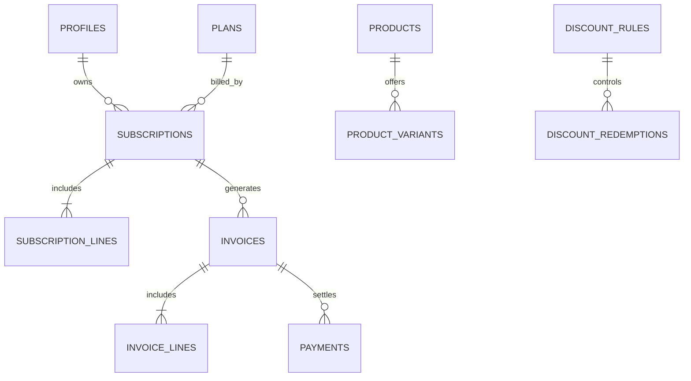

# Database design — Harsha review required

**Proposed entities**, not migrations: profiles/roles (Supabase Auth reference), products, product_variants (brand + price delta), plans (frequency, min quantity, availability, pause/renew/close policy), quotation_templates and template_lines, subscriptions (unique number, customer, plan, dates, payment terms, state, next_billing_at), subscription_lines, tax_rules, discount_rules (scope/type/threshold/dates/usage cap), invoices (period and statuses), invoice_lines (money snapshots), discount_redemptions, payments (method/amount/date/note/invoice).

Integrity: UNIQUE subscription number, UNIQUE(subscription_id,billing_period_start), positive quantities, decimal money, foreign keys, valid dates, transactionally enforced discount usage. Customer must see only own records via server checks and appropriate RLS. Index due subscriptions, invoice due/status and customer foreign keys. Seed clearly synthetic data only. One shared Supabase source of truth unless team re-approves.
