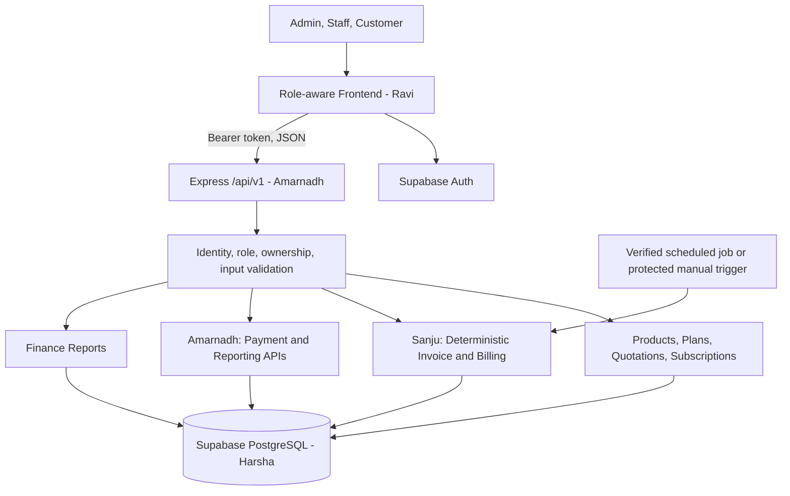

# System architecture — PROPOSED; team review required

The PS requires a single subscription platform, not a particular technology stack. Existing team preference: React/TypeScript frontend (Ravi), Node.js/Express API (Amarnadh), Supabase PostgreSQL/Auth (Harsha), integration/demo (Sanju). AI is optional and is not required by PS.

**Trust rules:** client cannot control amounts, roles or paid status; check ownership on each endpoint; server-only privileged credentials; apply RLS to exposed database tables. Use DB transactions and unique invoice-period key. Paginate/filter at server for thousands of subscriptions. Measure page load under two seconds; do not claim without proof.

**Failure:** DB write fails => rollback and safe retry. No email provider => clearly disclose unavailable sending. No scheduler => protected manual demo is not equivalent to automatic recurring execution.
