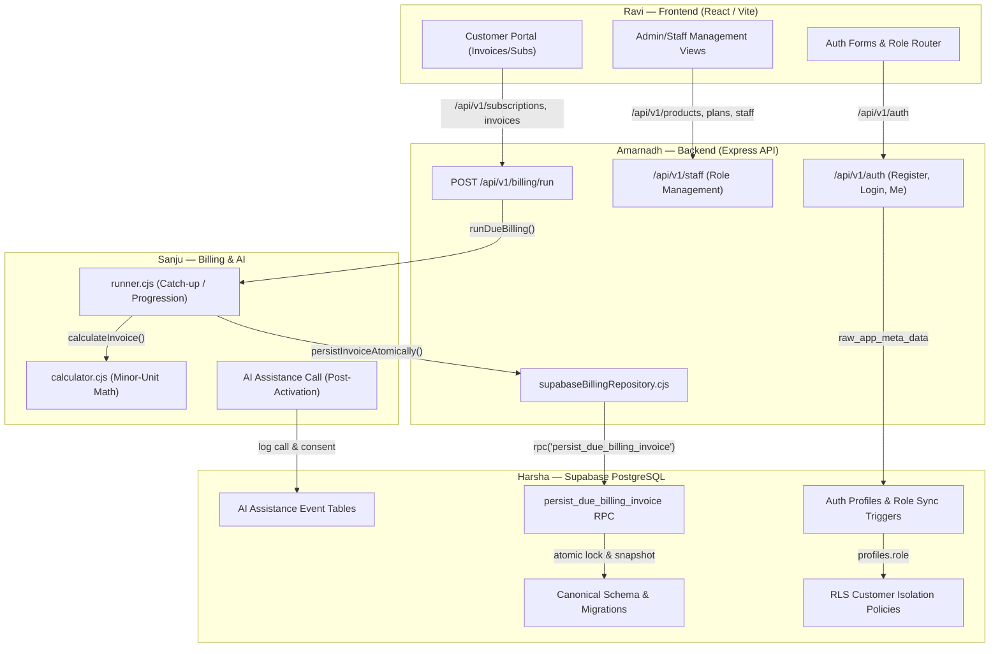

# Phase 0: Cross-Team Integration Matrix and Dependency Map
## Brightloop Software Subscription Management System — Odoo National Level Hackathon 2026

**Auditor:** Harsha (`harsha-1706`), Database Engineer  
**Workspace Root:** `E:\Projects\Odoo-Team`  
**Audit Date:** 2026-10-31  
**Audit Mode:** READ-ONLY Architectural Analysis  

---

## 1. Cross-Team Workstream Capabilities and Expectations

---

## 2. Detailed Module Dependency Analysis

### A. What Database Structures Ravi's Frontend Expects
Ravi is developing the user-facing application for two primary personas: Customers and Internal Staff/Admins.
1. **Identity & Auth:**
   - Supabase Auth integration via `@supabase/supabase-js`.
   - Access to user profile (`full_name`, `email`, `role`) on login to route customers to Portal and staff to Dashboard.
2. **Customer Portal:**
   - Read-only access to customer's own subscriptions: `id`, `subscription_number`, `status`, `start_date`, `next_billing_date`, plan name, product lines, totals.
   - Read-only access to customer's own invoices: `id`, `invoice_number`, `billing_period_start`, `due_date`, `status`, `total`, line item breakdown.
   - Read-only access to payments: `amount`, `method`, `paid_at`, `invoice_id`.
   - **Hard Security Requirement:** Customers must never receive or see another customer's data (enforced by RLS `customer_id = auth.uid()`).
3. **Admin / Staff Dashboard:**
   - Full management of `products`, `product_variants`, `plans`, `tax_rules`, and `discount_rules`.
   - Creation and progression of `quotation_templates`, `quotation_template_lines`, and `subscriptions`.
   - Confirmation and status progression of invoices (`draft` -> `confirmed` -> `paid`).
   - Payment entry recording against invoices.
   - Aggregate reporting queries (count of active subscriptions, total revenue, overdue balances) responding in under 2 seconds.

---

### B. What Database Structures Amarnadh's Backend Uses and Expects
Amarnadh's Express backend has merged Phase 1 Auth/RBAC and the protected billing adapter into `develop`:
1. **Authentication & RBAC (`backend/src/services/roleStore.js`):**
   - Stores user roles inside Supabase Auth's `auth.users.raw_app_meta_data->>'role'` using the server-side Service Role key.
   - **Expects the database to mirror this into `public.profiles.role`** so PostgreSQL RLS policies can evaluate user permissions without bypassing Auth security.
2. **Express Billing Route (`backend/src/routes/billing.cjs`):**
   - Protected endpoint `POST /api/v1/billing/run` requiring `admin` role.
   - Instantiates `createSupabaseBillingRepository()` and invokes `runDueBilling()`.
3. **Supabase Billing Repository (`backend/src/services/supabaseBillingRepository.cjs`):**
   - **Exact Table Queries:**
     - `subscriptions`: Queries `.select('id,status,customer_id,plan_id,start_date,next_billing_date,billing_anchor_date')`. Requires `status = 'active'`, `next_billing_date <= asOf`.
     - `plans`: Queries `.select('id,frequency,currency')`.
     - `subscription_lines`: Queries `.select('product_id,description,quantity,unit_price,variant_adjustment,tax_rate_percent')`.
     - `discount_rules`: Queries `.select('id,kind,value,scope,min_amount,min_quantity,valid_from,valid_until,max_uses,used_count')`.
     - `discount_product_mappings`: Queries `.select('discount_rule_id,product_id')` for rules where `scope = 'product'`.
   - **Exact RPC Invocation:**
     - Calls `client.rpc('persist_due_billing_invoice', { ... })` with:
       - `p_subscription_id`: UUID
       - `p_expected_date`: `YYYY-MM-DD`
       - `p_next_date`: `YYYY-MM-DD`
       - `p_due_date`: `YYYY-MM-DD`
       - `p_subtotal`: exact decimal string
       - `p_tax_total`: exact decimal string
       - `p_discount_total`: exact decimal string
       - `p_total`: exact decimal string
       - `p_lines`: JSONB array of line items (`productId`, `title`, `quantity`, `unitPrice`, `variantAdjustment`, `baseAmount`, `discountAmount`, `taxPercent`, `taxAmount`, `lineTotal`)
       - `p_discounts`: JSONB array of applied discounts (`id`, `amount`)
     - Expects return: `[{ result_status: 'created' | 'already-exists', result_invoice_id: UUID }]`.

---

### C. What Persistence Sanju's AI Workflow Needs
Sanju is architecting the Brightloop AI Innovation layer: an AI Assistance Call triggered upon confirmed subscription activation to onboard customers.
The database must provide the following dedicated persistence attributes:
1. **Customer Consent:** Explicit customer opt-in (`has_consented_ai_call BOOLEAN DEFAULT false`, `consent_recorded_at TIMESTAMPTZ`).
2. **Verified Contact Details:** Customer phone number (`phone_number TEXT`) and preferred calling window (`preferred_call_window TEXT`).
3. **Trigger Event Linkage:** Foreign key to the confirmed subscription (`subscription_id UUID REFERENCES subscriptions(id)`).
4. **Unique Assistance Event Identity:** UUID primary key (`event_id UUID DEFAULT gen_random_uuid()`).
5. **Idempotency Key:** Strict uniqueness constraint (`idempotency_key TEXT UNIQUE`) ensuring a customer never receives duplicate calls for the same subscription activation.
6. **Call Status State Machine:** `status TEXT CHECK (status IN ('scheduled', 'queued', 'in-progress', 'completed', 'failed', 'opted-out'))`.
7. **Retry Management:** Bounded retry counters (`retry_count INT DEFAULT 0`, `max_retries INT DEFAULT 3`).
8. **Scheduling Timestamps:** `scheduled_at`, `initiated_at`, `completed_at`, `next_retry_at TIMESTAMPTZ`.
9. **Provider Metadata:** `telephony_provider TEXT` (e.g. `'mock'`, `'twilio'`), `voice_provider TEXT` (e.g. `'murf'`), `provider_call_id TEXT`.
10. **Outcome & Transcript:** `outcome_summary TEXT`, `transcript_url TEXT`, `error_message TEXT`.
11. **Customer Opt-Out:** Capability for customer to opt out at any time (`opted_out_at TIMESTAMPTZ`, `opt_out_reason TEXT`).

---

### D. What Harsha's Current Database Branch Supplies
Harsha's local workspace (`database/migrations/001..005`) supplies an enterprise PostgreSQL architecture:
- 15 core domain tables covering Catalogue, Quotation Templates, Subscriptions, Invoices, Taxes, Discounts, Payments, and Profiles.
- Non-negotiable invoice period uniqueness: `UNIQUE (subscription_id, billing_period_start)`.
- Financial snapshot tables preserving exact historical billing lines (`invoice_lines`).
- Hardened RLS policies with `SECURITY DEFINER` helper `fn_current_user_role()`.
- Automated `updated_at` triggers and role escalation prevention triggers.
- Partial composite indexes for due subscriptions (`idx_subscriptions_due_billing`) and overdue invoices.
- Benchmark and integrity test harnesses (`database/tests/`).

---

### E. What Remains Missing
1. **Contract Alignment:** Harsha's local migration column names diverge slightly from `supabaseBillingRepository.cjs` (e.g. `state` vs `status`, `discount_rule_products` vs `discount_product_mappings`).
2. **RPC Signature Alignment:** Harsha's local `fn_generate_due_invoice()` does internal SQL-based calculation, whereas `develop` requires `persist_due_billing_invoice()` to ingest precomputed deterministic JavaScript billing snapshots.
3. **Auth Role Sync Trigger:** Need the two-way sync trigger that listens to updates on `auth.users.raw_app_meta_data` and mirrors role changes into `public.profiles.role`.
4. **AI Assistance Persistence:** The `ai_assistance_events` table is not yet authored in SQL.
5. **Live Supabase Execution:** No tables or RPCs have been executed on `bdmwwpfglltcpagwblmk`.

