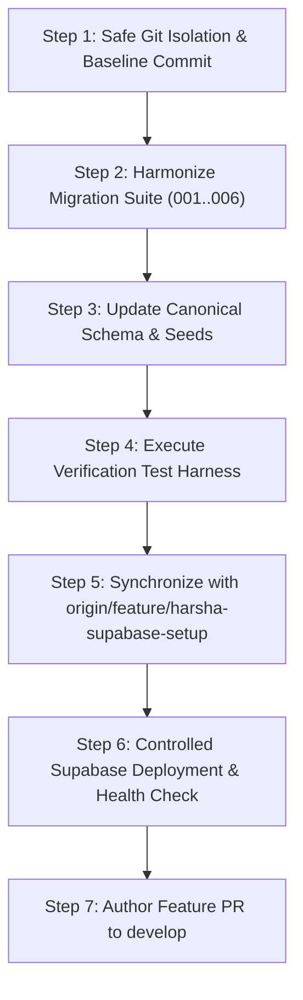

# Phase 1: Database Implementation & Migration Plan
## Brightloop Software Subscription Management System — Odoo National Level Hackathon 2026

**Author:** Harsha (`harsha-1706`), Database Engineer  
**Workspace:** `E:\Projects\Odoo-Team`  
**Target Project:** Supabase `bdmwwpfglltcpagwblmk` (`ap-southeast-2`)  
**Status:** READY FOR HARSHA'S APPROVAL  
**Date:** 2026-10-31  

---

## 1. Phase 2 Sequential Execution Plan

---

## 2. Detailed Step Specifications

### Step 1: Pre-Execution Safety & Git Isolation
1. **Isolate Conflicting Exploratory Files:**  
   Move untracked `backend/package.json` and `backend/src/` into `database/scaffolds/local_backend_exploratory/` to eliminate pull/merge collision while preserving 100% of Harsha's code.
2. **Review Staged Diff:**  
   Ensure zero files are deleted or overwritten.
3. **Commit Database Baseline:**  
   Commit all database migrations, seeds, test scripts, schemas, and documentation under:  
   `chore(db): archive exploratory backend and stage reconciled database architecture`.

---

### Step 2: Author Harmonized Migration Suite (`database/migrations/`)
Author 6 sequential, idempotent migrations that unite Harsha's enterprise architecture with the contracts required by `supabaseBillingRepository.cjs` and PR #15:

1. **`001_initial_schema.sql` (Reconciled Core Schema):**
   - Extensions: `pgcrypto`, `uuid-ossp`.
   - `public.profiles`: UUID PK references `auth.users(id)` on delete cascade, `email` unique, `full_name`, `role` (`admin`, `staff`, `customer`), `created_at`.
   - `public.products`: `id`, `name`, `type`, `sales_price NUMERIC(14,2)`, `cost_price NUMERIC(14,2)`, `notes`, `created_at`.
   - `public.product_variants`: `id`, `product_id`, `name`, `price_adjustment NUMERIC(14,2)`, unique `(product_id, name)`.
   - `public.plans`: `id`, `product_id REFERENCES products(id)`, `name`, `price NUMERIC(14,2)`, `currency CHAR(3)`, `frequency` (`daily`, `weekly`, `monthly`, `yearly`), `min_quantity`, `available_from`, `available_until`, `auto_close`, `allow_early_close`, `allow_pause`, `allow_renew`.
   - `public.tax_rules`: `id`, `name`, `rate_percent NUMERIC(5,2)`, `description`, `is_active`.
   - `public.quotation_templates`: `id`, `name`, `plan_id REFERENCES plans(id)`, `validity_days`.
   - `public.quotation_template_lines`: `id`, `template_id`, `product_id`, `variant_id`, `quantity`.
   - `public.subscriptions`: `id`, `subscription_number UNIQUE`, `customer_id`, `plan_id`, `status` (`draft`, `quotation`, `confirmed`, `active`, `paused`, `closed`), `start_date`, `expiry_date`, `payment_terms`, `next_billing_date`, `billing_anchor_date`.
   - `public.subscription_lines`: `id`, `subscription_id`, `product_id`, `variant_id`, `description`, `quantity`, `unit_price NUMERIC(14,2)`, `variant_adjustment NUMERIC(14,2)`, `tax_rate_percent NUMERIC(5,2)`.
   - `public.discount_rules`: `id`, `name`, `kind` (`percentage`, `fixed`), `value NUMERIC(14,2)`, `scope` (`subscription`, `product`), `min_amount`, `min_quantity`, `valid_from`, `valid_until`, `max_uses`, `used_count`.
   - `public.discount_product_mappings`: `(discount_rule_id, product_id) PK`.
   - `public.invoices`: `id`, `invoice_number UNIQUE`, `subscription_id`, `customer_id`, `billing_period_start`, `billing_period_end_exclusive`, `due_date`, `currency`, `status` (`draft`, `confirmed`, `paid`, `cancelled`), `subtotal`, `discount_total`, `tax_total`, `total`, `created_at`.
     - **Constraint:** `UNIQUE (subscription_id, billing_period_start)`.
   - `public.invoice_lines`: `id`, `invoice_id`, `product_id`, `description`, `quantity`, `unit_price`, `variant_adjustment`, `base_amount`, `discount_amount`, `tax_percent`, `tax_amount`, `line_total`.
   - `public.discount_redemptions`: `id`, `discount_rule_id`, `invoice_id`, `amount`, `redeemed_at`, `UNIQUE (discount_rule_id, invoice_id)`.
   - `public.payments`: `id`, `invoice_id`, `amount`, `method`, `paid_at`, `note`, `external_reference`, unique index on `(invoice_id, external_reference)` where not null.

2. **`002_constraints_and_functions.sql` (Billing RPC & Business Triggers):**
   - Triggers for `fn_set_updated_at()`.
   - Payment reconciliation trigger `fn_reconcile_payment()` advancing invoice status to `'paid'`.
   - **Atomic Billing RPC `persist_due_billing_invoice(...)`:**
     - Enforces `auth.role() = 'service_role'`.
     - Row-locks subscription `FOR UPDATE`.
     - Validates period cursor and returns `'already-exists'` if previously billed.
     - Row-locks applied discount rules in deterministic UUID order `FOR UPDATE`.
     - Validates line totals reconcile with snapshot subtotals.
     - Inserts invoice, lines, redemptions; updates cursor and usage counters.

3. **`003_rls_policies.sql` (Hardened Row Level Security):**
   - Enables RLS on all domain tables (deny by default).
   - Staff definer helper `is_brightloop_staff()`.
   - Customer isolation: `customer_id = auth.uid()`.
   - Staff/Admin full read access.
   - Zero client mutation policies (all writes routed via trusted backend).

4. **`004_indexes.sql` (Performance & High-Scale Optimization):**
   - Composite partial index: `idx_subscriptions_due_billing ON subscriptions(next_billing_date) WHERE status = 'active'`.
   - Overdue invoice index: `idx_invoices_due_status ON invoices(due_date, status) WHERE status != 'paid'`.
   - Foreign key join indexes on all relational paths.

5. **`005_auth_trigger.sql` (Auth Synchronization & Role Protection):**
   - Trigger `create_customer_profile()` on `auth.users` insert (default role `'customer'`).
   - Trigger `brightloop_auth_role_metadata_changed` on `raw_app_meta_data` update (syncs `profiles.role`).
   - Trigger `fn_prevent_role_escalation()` on `public.profiles` update.
   - Insert-only backfill query for existing development Auth users.

6. **`006_ai_assistance_events.sql` (AI Innovation Persistence):**
   - Table `public.ai_assistance_events`:
     - Customer consent, consent timestamp, phone number, preferred call window.
     - Confirmed subscription trigger linkage, idempotency key.
     - Status machine (`scheduled`, `queued`, `in-progress`, `completed`, `failed`, `opted-out`), retry counter, caps.
     - Timestamps, provider metadata, outcome summary, transcripts, opt-out reason.
   - RLS: Customer reads own; Staff manages all.

---

### Step 3: Canonical Schema, Diagrams & Seeds
1. Update `database/schema/01_brightloop_schema.sql` to represent the consolidated DDL.
2. Update `database/diagrams/schema_erd.mmd` to reflect the harmonized entities.
3. Update `database/seeds/001_seed_initial_data.sql`:
   - Valid synthetic seed records with `auth.users` stubs, products, Odoo Brand variant (+560.00), daily/weekly/monthly/yearly plans, subscriptions across all states, invoices, and payments.
4. Update `database/seeds/002_performance_benchmark_seed.sql` for high-volume scale testing.

---

### Step 4: Verification Test Harness
1. Run `database/tests/test_schema.sql` (verifies table existence, column types, constraints).
2. Run `database/tests/test_rls.sql` (verifies two-customer isolation and staff bypass).
3. Run `database/tests/test_billing_integrity.sql` (verifies unique billing period and RPC rollback).
4. Run `node database/tests/run_tests.js`.

---

### Step 5: Synchronize with Remote Tracking Branch
1. Fast-forward merge `origin/feature/harsha-supabase-setup` (`d9ad67c`).
2. Verify clean Git status (`ahead 1, behind 0`).

---

### Step 6: Controlled Supabase Deployment
1. Connect via pooled connection / Supabase MCP.
2. Apply migrations `001` through `006` sequentially.
3. Apply initial seed data `001_seed_initial_data.sql`.
4. Execute `node database/supabase/health_check.js` to verify operational status.

---

### Step 7: Push & Feature PR to `develop`
1. Push `feature/harsha-supabase-setup` to `origin/feature/harsha-supabase-setup`.
2. Verify GitHub remote head matches local commit.
3. Open Feature PR: `feature/harsha-supabase-setup` -> `develop`.

