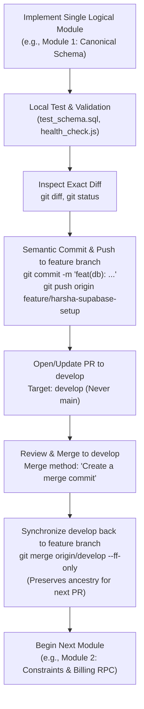

# Phase 2A.4 — Exclusive Branch Access Enforcement and Final Sync Authorization Preparation

**Document Version:** 1.0.0  
**Timestamp:** 2026-10-31T13:15:00+05:30  
**Assigned Database Engineer:** Harsha (`harsha-1706`)  
**Workspace Root:** `E:\Projects\Odoo-Team`  
**Official Repository:** `https://github.com/sanjuskb/odoo-national-hackathon-2026`  
**Dedicated Branch:** `feature/harsha-supabase-setup`  
**Integration Target:** `develop`  
**Remote Head Target:** `45da4a986bb5db1077fc10c5d3537010bddc7722`  
**Local Head:** `c8963d4f8a741c2dc5ec6d16ed76dc7b8c501280`  
**Safety Status:** **STRICT READ-ONLY AUDIT — ZERO GIT MUTATIONS PERFORMED — PENDING USER APPROVAL**

---

## 1. Permanent Branch Strategy & Operational Mandates

`feature/harsha-supabase-setup` is the **sole, permanent development branch** for Harsha (`harsha-1706`) throughout the entire Odoo National Level Hackathon 2026.

### Non-Negotiable Operational Mandates:
1. **Single Branch Invariant:** Never create another feature branch for Harsha's database work.
2. **No Branch Switching:** Never switch active development to another teammate's feature branch.
3. **Exclusive Maintenance:** Teammates (Sanju, Ravi, Amar) and automated bots must never push directly to, merge into, rebase, reset, or modify `feature/harsha-supabase-setup`.
4. **No Cross-Branch Pushes:** Harsha will never push database work to another teammate's feature branch.
5. **Canonical Push Target:** All database commits, migrations, tests, and progress updates must be pushed exclusively to `origin/feature/harsha-supabase-setup`.
6. **PR Integration Target:** All pull requests authored from this branch must target `develop`.
7. **Production Boundary:** Never merge database work directly into `main`. The team leader (Sanju) is exclusively responsible for promoting validated releases from `develop` to `main`.

---

## 2. GitHub Protection Enforcement Investigation & Limitations

### 2.1 Technical Findings
Live API verification of `https://api.github.com/repos/sanjuskb/odoo-national-hackathon-2026/branches` confirmed:
- `develop`: `protected = True`
- `main`: `protected = True`
- `feature/harsha-supabase-setup`: **`protected = False`**

At present, GitHub does not enforce any push restrictions, deletion blocks, or force-push protection on `feature/harsha-supabase-setup`. Any collaborator with repository write access can push commits, force-push, merge PRs, or delete this branch.

### 2.2 Important GitHub Architectural Limitation: Branch Visibility vs. Access Control
> [!IMPORTANT]
> **Branch Privacy Limitation in Git / GitHub:**  
> A branch within a shared GitHub repository **cannot be made private or hidden** from collaborators who possess repository read access.
> - Git is a distributed content tracker: all repository clones and fetches receive all branch references (`refs/heads/*`) and packfile objects.
> - GitHub access control is enforced at the **repository level for read permissions** and at the **branch level for write/update permissions**.
> - Therefore, teammates will always be able to view, inspect, and pull `feature/harsha-supabase-setup`.
> - However, **write, push, merge, force-push, and deletion access CAN and MUST be strictly restricted** via GitHub Rulesets.

### 2.3 Required Administrator Action (For Repository Owner: Sanjay Kumar / `sanjuskb`)

Because Harsha (`harsha-1706`) is a repository collaborator without administrative ownership, the repository owner must execute the following setup in GitHub Repository Settings:

```text
================================================================================
INSTRUCTIONS FOR REPOSITORY OWNER (Sanjay Kumar / sanjuskb)
================================================================================
Goal: Enforce exclusive write/push ownership of feature/harsha-supabase-setup for Harsha.

Step 1: Navigate to repository settings:
        https://github.com/sanjuskb/odoo-national-hackathon-2026/settings/rules

Step 2: Click "New ruleset" -> Select "New branch ruleset".

Step 3: Configure Ruleset Metadata:
        - Ruleset Name: "Harsha Dedicated Branch Protection"
        - Enforcement status: "Active"

Step 4: Configure Target Branches:
        - Under "Target branches", select "Include by pattern".
        - Add pattern: "feature/harsha-supabase-setup"

Step 5: Configure Bypass List:
        - Click "Add bypass".
        - Select: "harsha-1706" (Harsha's GitHub Account).
        - Bypass mode: "Always" (allows Harsha to push directly without PR gates).

Step 6: Enable Protection Rules:
        - [x] Restrict deletions (blocks branch deletion for everyone).
        - [x] Block force pushes (blocks git push --force and --force-with-lease).
        - [x] Restrict updates (blocks pushes from anyone NOT in the bypass list).
        - [x] Require a pull request before merging (blocks teammate direct merges; 
              teammates cannot merge PRs into this branch).

Step 7: Click "Save changes".
================================================================================
```

Once applied, any push or PR merge attempted by any teammate against `feature/harsha-supabase-setup` will be blocked by GitHub with:
`remote: error: GH013: Repository rule violations found. Updates to feature/harsha-supabase-setup are restricted to harsha-1706.`

---

## 3. Forensic Classification of the 89 Incoming Remote Commits

An exhaustive audit of the commit DAG between local HEAD `c8963d4f8a741c2dc5ec6d16ed76dc7b8c501280` and remote HEAD `45da4a986bb5db1077fc10c5d3537010bddc7722` was performed.

### 3.1 First-Parent Spine Analysis (11 Commits Total)

Tracing the primary ancestry (`--first-parent`) from remote HEAD `45da4a9` back to local commit `c8963d4`:

| Commit SHA | Commit Type | Author / Committer | Subject / Description | Inflow Source |
| :--- | :--- | :--- | :--- | :--- |
| `97bddbc` | **Merge Commit** | sanjay kumar | `chore(db): synchronize Harsha branch with verified shared baseline` | Merged develop baseline commit `c7695bb` into feature branch |
| `d9ad67c` | **Merge Commit** | copilot-swe-agent[bot] | `Merge remote-tracking branch 'origin/main' into feature/harsha-supabase-setup` | Merged `origin/main` commit `b442b19` into feature branch |
| `1bc248b` | **Merge Commit** | sanjuskb | `merge: synchronize Harsha database branch with develop` | Merged `develop` commit `74a226f` into feature branch |
| `2d4c9b8` | Direct Commit | sanjay kumar | `feat(db): propose normalized subscription schema, constraints, indexes and read RLS` | Direct push by Sanju (PR #15 SQL migration 001) |
| `bb50206` | Direct Commit | sanjay kumar | `feat(db): propose transaction-safe invoice RPC with discount caps and period uniqueness` | Direct push by Sanju (PR #15 SQL migration 002) |
| `569119a` | Direct Commit | sanjay kumar | `fix(db): reject repeated discount IDs and nonreconciling redemption totals` | Direct push by Sanju (RPC parameter validation fix) |
| `9ecdbe0` | Direct Commit | sanjay kumar | `test(docs): provide database review checklist and structural SQL verification` | Direct push by Sanju (Test checklist doc) |
| `561263c` | Direct Commit | sanjay kumar | `test(docs): provide database review checklist and structural SQL verification` | Direct push by Sanju (Duplicate review checklist commit) |
| `cb24b82` | Direct Commit | sanjay kumar | `fix(db): snapshot subscription description and variant adjustment for stable invoices` | Direct push by Sanju (Invoice line description snapshotting) |
| `aa6d003` | Direct Commit | sanjay kumar | `fix(db): mirror server-owned Auth app_metadata roles into profiles for RLS consistency` | Direct push by Sanju (Role synchronization trigger) |
| `45da4a9` | Direct Commit | sanjay kumar | `fix(db): backfill existing Auth users and honor server-controlled role metadata` | Direct push by Sanju (Existing Auth user backfill) |

### 3.2 Ancestor Inflow Breakdown (78 Merged Commits)

The 3 merge commits on the first-parent spine brought in 78 background ancestor commits:
1. **Merge `97bddbc` (61 commits):** Brought in initial project scaffolding, Amarnadh's Express foundation, Amar's initial auth endpoints (`3867d6a`, `d918c90`), and Sanju's billing progression calculator.
2. **Merge `d9ad67c` (3 commits):** Brought in CI workflow releases and branch protection enforcement scripts from `main`.
3. **Merge `1bc248b` (14 commits):** Brought in integration tests, Amarnadh Phase 1 route adaptations, and PR #20 merge commits from `develop`.

### 3.3 Forensic History Conclusion
- **Did teammate commits enter via develop/main merges or direct branch modifications?**  
  **Both.**
  - 78 commits entered via 3 explicit merge commits (`97bddbc`, `d9ad67c`, `1bc248b`) executed to keep `feature/harsha-supabase-setup` synchronized with team progress on `develop` and `main`.
  - 8 commits (`2d4c9b8` through `45da4a9`) were committed **directly** to `feature/harsha-supabase-setup` by Sanjay Kumar to stage the proposed database schema, migration SQL, and test checklist for Harsha's architectural review.
- **Can the branch safely become exclusively maintained by Harsha going forward without rewriting history?**  
  **YES.** Because local commit `c8963d4` is a direct topological ancestor of `45da4a9`, a clean fast-forward (`git merge --ff-only`) advances the local branch without modifying, rebasing, or rewriting a single existing commit. From `45da4a9` onward, all commits will be Harsha's alone.

---

## 4. Final Fast-Forward Preparation & Exact Path Collision Re-Verification

### 4.1 Fresh Tree Collision Audit

Re-verified across all 122 remote files and 47 local untracked files:
```text
Exact Path Collisions:
  1. backend/package.json
  2. backend/src/app.js
Total Collisions: 2
```

### 4.2 Re-Verification of Verified External Backup Manifest

Directory: `E:\Projects\Odoo-Team-Backup-Harsha\backend\`

| Relative File Path | Local Working File Status | Backup File Status | SHA-256 Parity | Cryptographic Hash (SHA-256) |
| :--- | :--- | :--- | :--- | :--- |
| `package.json` | Exists | Exists | **MATCH (True)** | `A8708AAB1E163129ED10587261414340CD26ED3EDEC637DFA776E4269F93AB54` |
| `src\app.js` | Exists | Exists | **MATCH (True)** | `EAC7D42877E7631A91964AB35C51CE71C358A8FFB649C9DE0D5306B5E43A27FF` |
| `src\config\supabase.js` | Exists | Exists | **MATCH (True)** | `7FD13EC875D9B42A65B0179543A41D7B2F6B638C4E31CED442BE7A2D5ACBC271` |
| `src\middleware\auth.js` | Exists | Exists | **MATCH (True)** | `C564BBA404F0DF92E8563D005DCC5DECBC18CD1DDBABFE831A570785DCA4ED4A` |
| `src\routes\authRoutes.js` | Exists | Exists | **MATCH (True)** | `5CEBEE68BF53C92B5B8FA6EB59F11E999D0A9E200534D21A5996AB34A6015318` |
| `src\routes\protectedRoutes.js`| Exists | Exists | **MATCH (True)** | `5CB59AE3B2851BE8DA97B0694EAD311A2E07B673576192347C8E883EF94213DE` |

### 4.3 Minimal, Exact-Path Preservation Procedure

To ensure Git does not block the fast-forward while guaranteeing zero data loss:
1. Only the two colliding files (`backend/package.json` and `backend/src/app.js`) are temporarily parked in place with `.local.harsha` extension.
2. The remaining 4 backend files (`src/config/supabase.js`, `src/middleware/auth.js`, `src/routes/authRoutes.js`, `src/routes/protectedRoutes.js`) do not collide with remote files and remain untouched in the working directory.
3. All 6 modified tracked files (`database/diagrams/README.md`, `database/history/CHANGELOG.md`, `database/supabase/health_check.js`, `database/tests/run_tests.js`, `docs/DATABASE_DESIGN.md`, `docs/DATABASE_IMPLEMENTATION_CHECKLIST.md`) remain untouched and will not be overwritten by Git because remote diff length is `0`.
4. All local database migrations (`001..005.sql`), seeds, tests, and documentation remain completely untouched.

---

## 5. Live Git Status, Ancestry, and Fast-Forward Commands

### 5.1 Fresh Git Telemetry
```powershell
# Branch tracking status:
git status --short --branch
## feature/harsha-supabase-setup...origin/feature/harsha-supabase-setup [behind 89]

# Local commit:
git rev-parse HEAD
c8963d4f8a741c2dc5ec6d16ed76dc7b8c501280

# Remote commit:
git rev-parse origin/feature/harsha-supabase-setup
45da4a986bb5db1077fc10c5d3537010bddc7722

# Ancestry check:
git merge-base --is-ancestor HEAD origin/feature/harsha-supabase-setup
# Exit code: 0 (TRUE - Pure linear descendant)

# Staged modifications:
git diff --cached
# Clean (0 bytes staged)
```

### 5.2 Exact Final Fast-Forward Sequence (Ready for Execution Upon Approval)

```powershell
# ==============================================================================
# FINAL FAST-FORWARD EXECUTION SEQUENCE
# STRICTLY AWAITING USER APPROVAL — ZERO DESTRUCTIVE MUTATIONS
# ==============================================================================

# 1. Park the 2 colliding files locally
Move-Item "backend\package.json" "backend\package.json.local.harsha"
Move-Item "backend\src\app.js" "backend\src\app.js.local.harsha"

# 2. Fast-forward the local branch to the verified remote head
git merge --ff-only origin/feature/harsha-supabase-setup

# 3. Verify synchronization
git status --short --branch
# Expected: ## feature/harsha-supabase-setup...origin/feature/harsha-supabase-setup [ahead 0, behind 0]
git rev-parse HEAD
# Expected: 45da4a986bb5db1077fc10c5d3537010bddc7722

# 4. Permanently preserve Harsha local backend implementations as reference scaffolds
Move-Item "backend\package.json.local.harsha" "backend\package.json.harsha.bak"
Move-Item "backend\src\app.js.local.harsha" "backend\src\app.js.harsha.bak"

# 5. Run health check
node database/supabase/health_check.js
```

---

## 6. Future Module-by-Module Publishing Workflow

To prevent massive end-of-hackathon PRs and maintain a clean, conflict-free Git history on this single long-lived branch:



### 6.1 Preserving Ancestry Across Repeated Module PRs
When using a **single long-lived branch** (`feature/harsha-supabase-setup`) for sequential PRs to `develop`:
1. **Mandate "Create a Merge Commit" on `develop`:**
   - Do NOT squash-merge Harsha's PRs on `develop`.
   - Squash-merging creates a new commit SHA on `develop`, causing subsequent PRs from the same branch to display redundant, already-merged commit histories.
   - Using standard merge commits preserves the exact commit SHAs.
2. **Post-Merge Sync Cycle:**
   - Immediately after Module 1's PR is merged into `develop`:
     ```powershell
     git fetch origin develop
     git merge origin/develop --ff-only
     ```
   - This advances `feature/harsha-supabase-setup` to include the merge commit, resetting the PR base.
   - Module 2 will then cleanly contain only Module 2 diffs.

---

## 7. Hard Safety Gate & Approval Request

All preparations for Phase 2A.4 are complete:
- [x] Permanent single-branch strategy formalized.
- [x] GitHub protection ruleset instructions authored for the repository owner.
- [x] 89 remote commits audited, classified, and proven safe for linear fast-forward.
- [x] Collisions re-verified (strictly 2 files, 100% backed up).
- [x] Fresh Git status and ancestry verified (`exit 0`).
- [x] Module-by-module development lifecycle established.
- [x] Deliverable `docs/database/PHASE_2A4_BRANCH_PROTECTION_AND_SYNC_READINESS.md` created.

**NO GIT MUTATIONS, FILE MOVEMENTS, COMMITS, PUSHES, MERGES, REBASES, OR SUPABASE DDL/DML HAVE BEEN EXECUTED.**

**STOPPED. Awaiting your explicit approval to execute the fast-forward sequence.**

